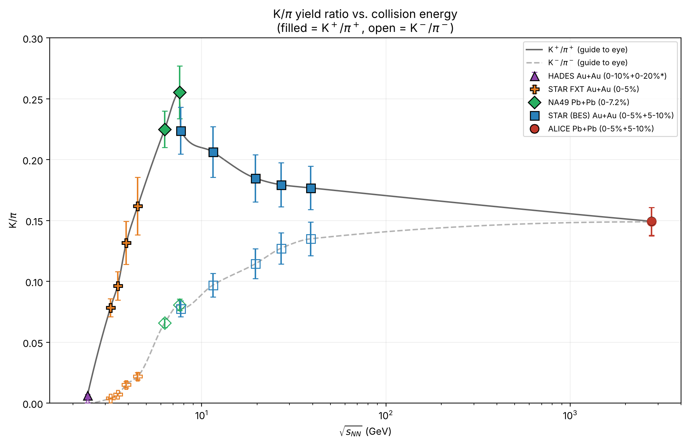

# K/π horn and Thermal-FIST freeze-out fits

[](LICENSE)


Code and data for a paper on the **K/π "horn"** and on thermal fits of particle ratios with
[Thermal-FIST](https://github.com/vlvovch/Thermal-FIST), a hadron resonance gas (HRG) code. Data come from
HADES, STAR (fixed-target and Beam Energy Scan), NA49 and ALICE, from √s<sub>NN</sub> = 2.4 GeV to 2.76 TeV.



## The question

K⁺/π⁺ rises with collision energy, peaks near √s<sub>NN</sub> ≈ 7–8 GeV (the "horn") and then falls, while
K⁻/π⁻ rises steadily until the two meet at the LHC. At HADES (2.4 GeV) K⁺/π⁺ is only 0.0064, about 25 times
below its value at 4.5 GeV, so few strange particles are produced.

**Hypothesis H1.** At that lowest energy, an ensemble that conserves strangeness *exactly* (strangeness-canonical,
SCE) describes the data better than one that conserves it only *on average* (grand-canonical, GCE).

## Results

| HADES, 2.4 GeV | χ² | dof | *p* | Free parameters |
|---|---|---|---|---|
| Grand-canonical (GCE) | 12.30 | 2 | 0.0021 | T |
| Strangeness-canonical (SCE) | 3.24 | 1 | 0.072 | T, R<sub>c</sub> = 21 ± 6 fm |

Adding R<sub>c</sub> lowers χ² by 9.06 (*p* = 0.0026 for one extra parameter), far more than the ≈ 1 expected from
an extra parameter that does nothing. This supports H1 but does not prove it:

* only three ratios are fitted at HADES, so the SCE fit has one degree of freedom;
* R<sub>c</sub> is larger than the colliding nuclei, and almost all of the remaining χ² comes from π⁻/π⁺;
* μ<sub>B</sub> is fixed to a literature curve, not fitted.

Other results: the method reproduces STAR's published T and μ<sub>B</sub> within 1σ (γ<sub>S</sub> differs by up to
1.6σ), and the HADES and FXT temperatures lie about 16–22 MeV below the Cleymans freeze-out curve (unexplained).

## Figures

| | |
|---|---|
| `fig1_horn.png` | K⁺/π⁺ and K⁻/π⁻ versus √s<sub>NN</sub> |
| `fig2_benchmark_vs_STAR.png` | our STAR fits against STAR's published fits |
| `fig3_phase_diagram.png` | freeze-out phase diagram, T versus μ<sub>B</sub> |
| `fig4_HADES_ensemble_comparison.png` | H1 test: HADES ratios under the two ensembles |
| `fig5_horn_model_check.png` | extra: model K/π at the fitted parameters against the measured horn |

## Quick start

```bash
git clone https://github.com/bwash2027/horn-thermal-fist.git
cd horn-thermal-fist
python -m venv .venv && source .venv/bin/activate     # Windows: .venv\Scripts\activate
pip install -e .                                      # numpy, pandas, scipy, matplotlib
python scripts/make_figures.py                        # rebuilds results/, figures/ and the figure data
jupyter lab notebooks/KtoPi_horn_and_thermal_fits.ipynb   # the same analysis, step by step
```

Thermal-FIST itself is **not** needed to reproduce the figures: its outputs are included in
`data/thermal_fist/outputs/`. To repeat a fit, load the matching file from `data/thermal_fist/inputs/` into
Thermal-FIST (v1.6.1, PDG2025 list) with the settings in [`data/SOURCES.md`](data/SOURCES.md).

## Repository layout

```
data/
  raw/                      hand-transcribed yields, with source and feed-down convention for every row
  thermal_fist/inputs/      ratio files fitted in Thermal-FIST (.dat)
  thermal_fist/outputs/     Thermal-FIST fit results (fit_*.txt)
  reference/                STAR's published fits (benchmark for Fig. 2)
  SOURCES.md                every source, feed-down convention and known limitation
results/
  horn_ratios.csv                      K/π ratios and errors per energy
  thermal_fit_results_selected.csv     the 16 fits used in the paper
  low_energy_offsets_from_curve.csv    HADES/FXT temperature minus the Cleymans curve
  figure_data/                         the exact numbers plotted in each figure
figures/                    Figures 1-5 (PNG)
notebooks/                  the analysis as a notebook that calls the package
src/horn_thermal/           config.py  horn.py  fits.py  plotting.py  pipeline.py
scripts/make_figures.py     one-command rebuild
```

### Data behind each figure (`results/figure_data/`)

| File | Contents |
|---|---|
| `fig1_horn_points.csv`, `fig1_horn_guide_curves.csv` | K/π points with errors; the PCHIP guide lines (a guide to the eye, not a fit) |
| `fig2_benchmark_vs_STAR.csv` | our T, μ<sub>B</sub>, γ<sub>S</sub> with errors, STAR's published values, and the difference in σ |
| `fig3_freezeout_points.csv`, `fig3_curve_Cleymans.csv`, `fig3_curve_Andronic_type.csv` | freeze-out points and the two literature curves |
| `fig4_HADES_ratios.csv` | HADES data, GCE and SCE model values and pulls for π⁻/π⁺, K⁺/π⁺, K⁻/K⁺ |
| `fig5_horn_model_check.csv` | model and measured K/π with pulls at every energy |

## Method in brief

* **Horn.** Ratios of integrated yields. When an experiment quotes two centrality classes (0–5 %, 5–10 %) they are
  averaged. Ratio errors add the two yield errors in quadrature and treat them as uncorrelated (conservative).
* **Fits.** Particle *ratios*, so the volume cancels in the GCE. STAR, NA49, ALICE: T, μ<sub>B</sub>, γ<sub>S</sub> free.
  HADES and FXT: only T free, μ<sub>B</sub> fixed to the Cleymans freeze-out curve, γ<sub>S</sub> = 1. The HADES SCE fit
  also fits R<sub>c</sub>. Net strangeness 0 and Q/B = 0.4 (μ<sub>Q</sub> = 0 for ALICE).
* **Statistics.** χ² = Σ (r<sub>model</sub> − r<sub>data</sub>)² / σ²; dof = N − N<sub>free</sub>; *p* from the χ² survival function.
* **Fit selection.** The valid fit for each data point is chosen from the *contents* of the output files (data file,
  model, fixed parameters, limits), so superseded or failed runs are skipped automatically.

## Known limitations

* Yields were transcribed by hand from the papers. **Check them against the originals.**
* The STAR FXT source publication is still to be added (`data/raw/…csv`, `data/SOURCES.md`).
* The horn mixes 4π multiplicities (HADES) with mid-rapidity dN/dy, and different centralities.
* Feed-down conventions differ between datasets (see `data/SOURCES.md`); the effect was tested, not removed.
* The dashed curve in Fig. 3 is an "Andronic-type" parametrization whose citation is unconfirmed (`config.ANDRONIC`).
* Fig. 5 is partly circular: each energy was fitted to the same ratios it is compared with.
* **Data correction.** An earlier version of the raw yield table listed the STAR FXT rows twice, which made the FXT
  K/π error bars too small by a factor √2. This is fixed, and the loader now rejects duplicate rows
  (details in `data/SOURCES.md`).

## Citing and credits

If you use this repository, please cite it together with the data and software it builds on:

* **Data:** HADES (Eur. Phys. J. A 56, 259; Phys. Lett. B 778, 403), STAR fixed target, NA49 (Phys. Rev. C 77, 024903;
  Phys. Rev. C 73, 044910), STAR BES (Phys. Rev. C 96, 044904), ALICE (Phys. Rev. C 88, 044910).
* **Software:** Thermal-FIST, V. Vovchenko and H. Stoecker, Comput. Phys. Commun. 244, 295 (2019), arXiv:1901.05249.
* **Freeze-out curve:** J. Cleymans, H. Oeschler, K. Redlich and S. Wheaton, Phys. Rev. C 73, 034905 (2006).

Full references are in [`data/SOURCES.md`](data/SOURCES.md).

## License

The code and the notebook are released under the [MIT License](LICENSE). The yields in `data/raw/` and the reference
values in `data/reference/` were taken from the published papers listed above and remain the work of the respective
collaborations; please cite them when you reuse those numbers.
